# MagicPerspective — Galerie pentru arhiva conversației

## Cele șase imagini originale ale utilizatorului — copiate fără modificarea octeților

**IMPORTANT:** Fișierele au nume sursă .png, dar bytes originali sunt JPEG. Au fost stocate ca .jpg pentru vizualizare, fără recomprimare și fără modificarea conținutului.

### Mesajul 1 — trei capturi din articolul Walesiak

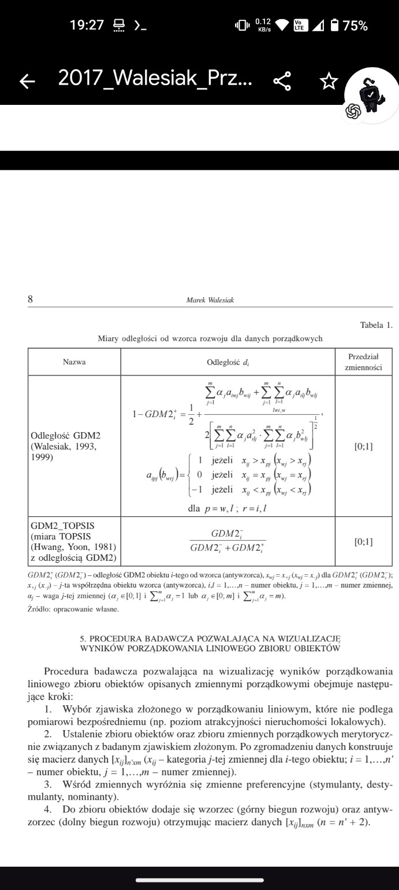

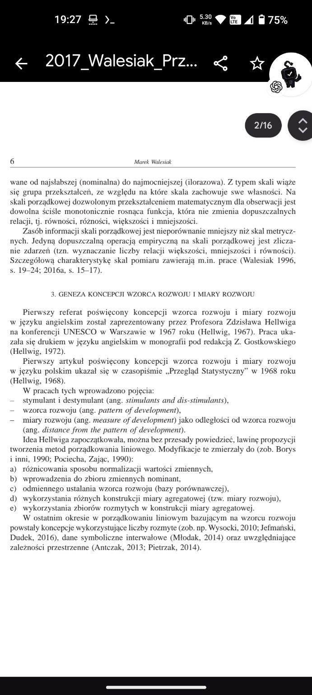

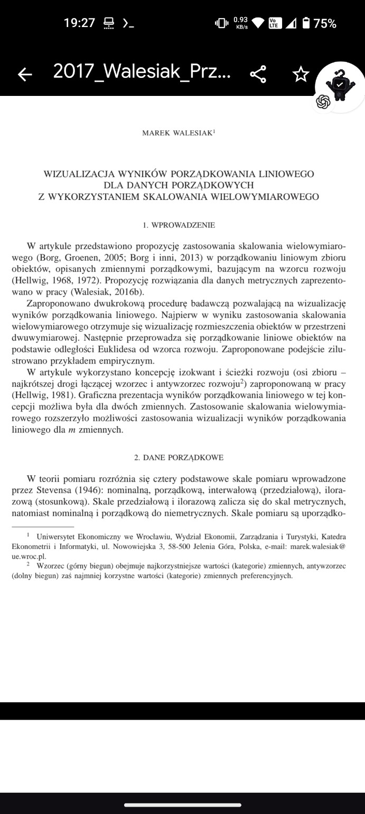

### Mesajul 46 — două capturi din materialul discutat

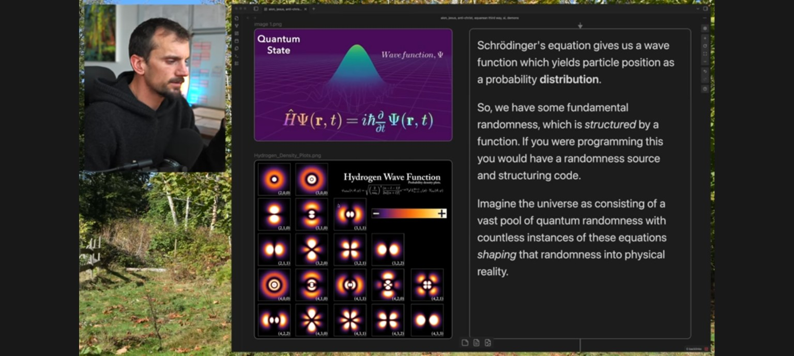

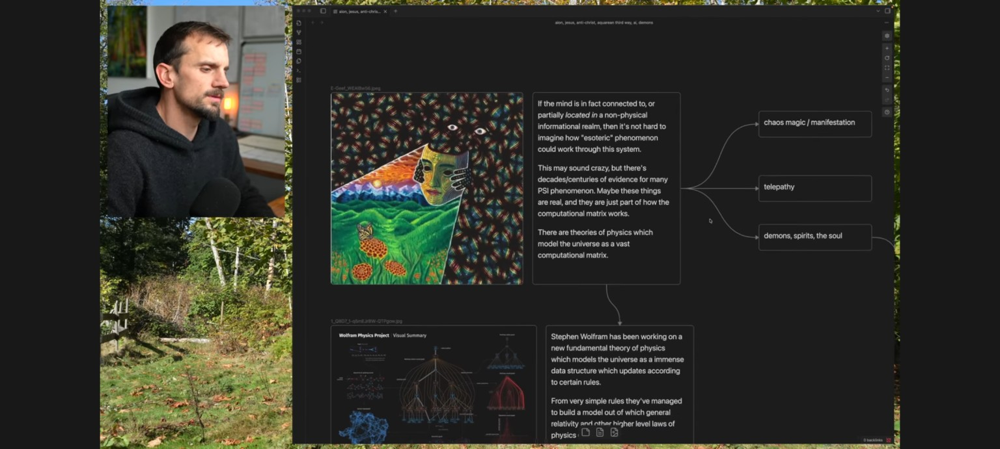

### Mesajul 48 — captură mărită

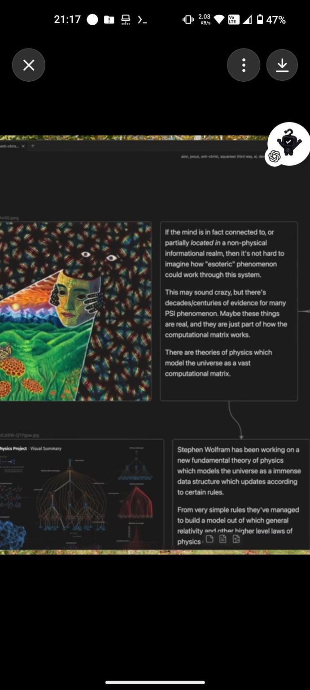

## Diagramele asistentului (SVG)

**STATUT:** Acestea sunt **reconstituiri vizuale din conversație**, nu exporturi pixel-perfect din interfața originală. Etichetele și geometria urmăresc diagramele descrise și afișate anterior, dar un export oficial al randării nu a fost disponibil.

### Mesajul 2 — clasificare MDS (reconstituit)

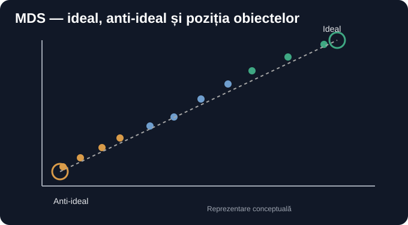

### Mesajul 4 — organismele și perspectivele (reconstituit)

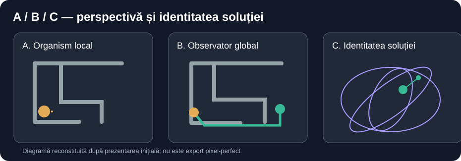

### Mesajul 38 — observație / reconstrucție / predicție (reconstituit)

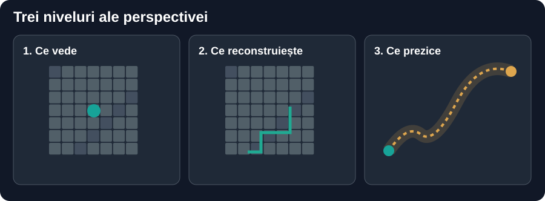

### Mesajul 38 — OPFS (reconstituit)

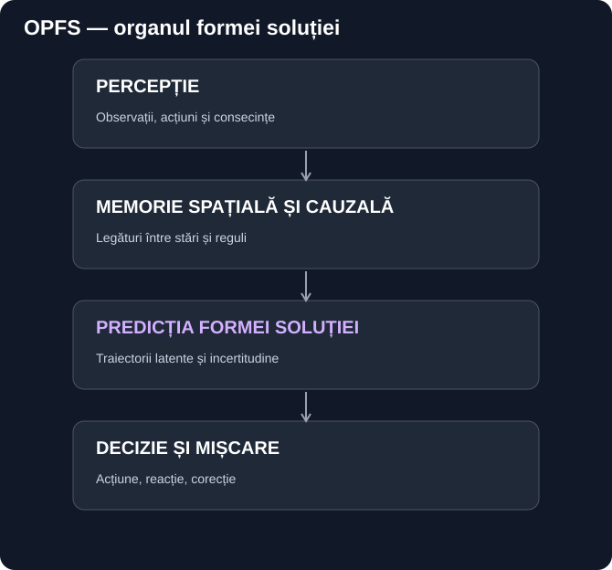

### Mesajul 38 — traseu anticipat vs referință (reconstituit)

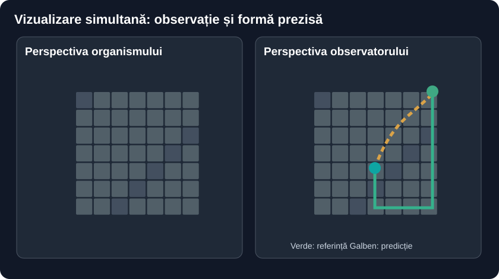

### Mesajul 45 — arhitectura bazată pe slice-uri (reconstituit)

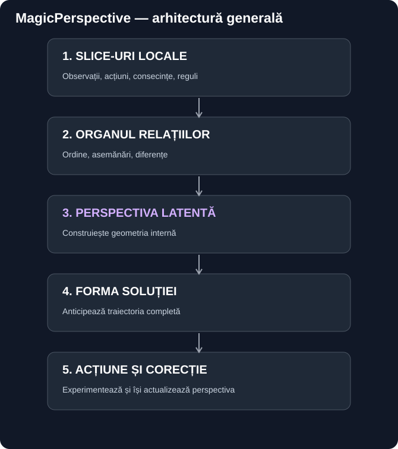

### Mesajul 49 — bucla predicție–acțiune–rezistență (reconstituit)

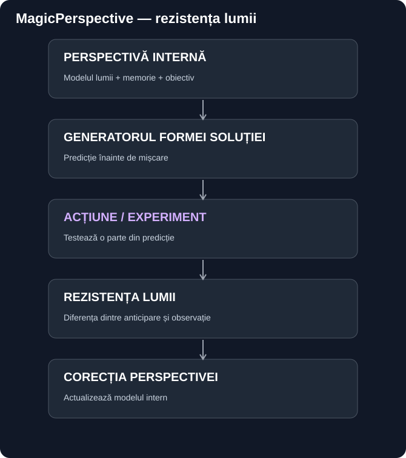

## Ce înseamnă „verbatim” aici

Mesajele text au fost păstrate în [transcriere](CONVERSATIE_COMPLETA_DIN_CONTEXT.md), inclusiv continuarea până la mesajul 50.

Capturile utilizatorului: fișiere originale, comparate prin SHA de obiect Git.

Graficele generate de asistent: reproducere **nu byte-for-byte**; componenta originală din interfața ChatGPT nu este disponibilă pentru extragere.

Nu se afirmă că reprezentările regenerate sunt identice la nivel de pixel cu cele originale.
